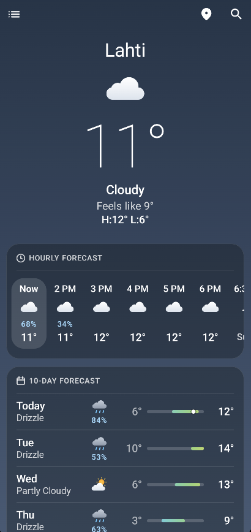
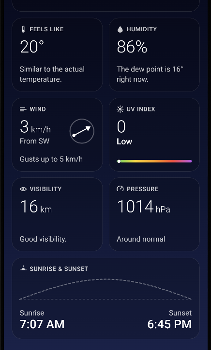
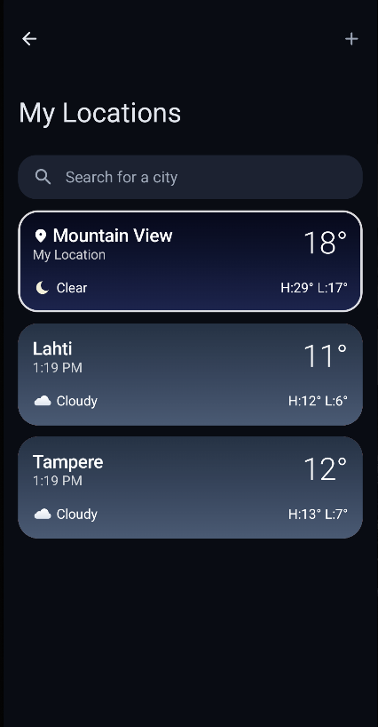
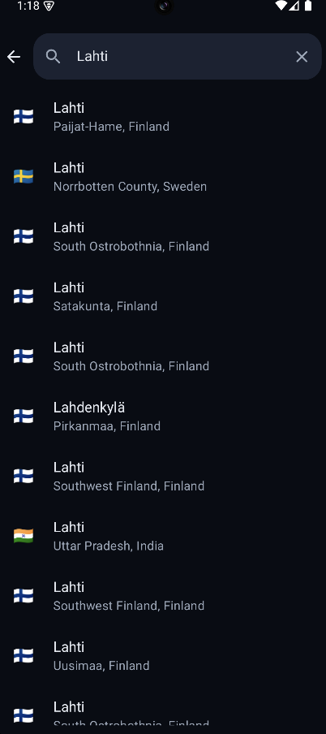
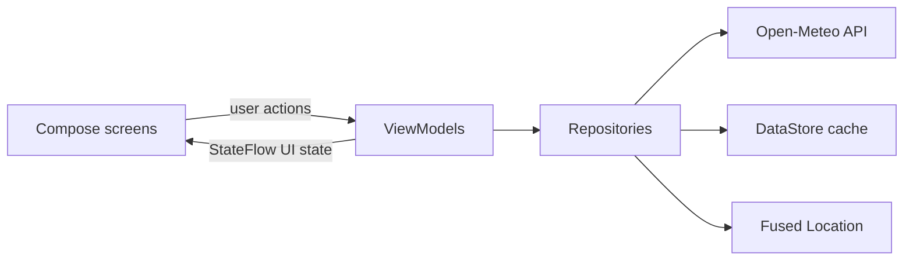

<div align="center">


# WeatherApp

**A calm, card-based Android weather app inspired by iOS Weather — built natively with Kotlin and Jetpack Compose.**


</div>

## Screenshots

| Home | Details | My Locations | Search |
|:---:|:---:|:---:|:---:|
|  |  |  |  |

## Features

- **Current weather at a glance:** a large thin-weight temperature, the condition, "feels like" and today's high/low.
- **24-hour forecast:** a horizontal strip that highlights the current hour, shows the chance of rain, and adds sunrise/sunset markers at the right times.
- **10-day forecast:** each day has a temperature-range bar coloured by absolute temperature, with a dot for the current temperature on today's bar.
- **Detail tiles:** feels like, humidity with dew point, wind with a compass, UV index scale, visibility and pressure.
- **Sunrise and sunset:** a card showing the sun's path across the sky and where it is right now.
- **City search:** search runs as you type, and results show country flags.
- **Saved locations:** each card uses the city's own weather gradient. Swipe to remove a city.
- **Current location:** uses approximate location, and the app only asks for permission when the user taps the location button.
- **Weather-aware backgrounds:** the gradient changes for clear, cloudy, rain, snow, storm, fog and night, and animates between cities.
- **Loading, errors and offline:** a skeleton shimmer while loading and pull-to-refresh. Without a connection the app shows the last cached forecast with *"Updated 08:42"*. Error screens explain no internet, timeouts, server problems, location access and unknown cities.
- **Dark theme:** a separate night-sky palette, not inverted colours.
- **Adaptive layout:** one column on phones, three-column detail tiles on wider screens, two panes on tablets.
- **Accessibility:** content descriptions, merged readouts for forecast rows, 48dp touch targets, support for font scaling, and a custom "Remove" accessibility action.

## Tech stack

| Area | Tools |
|---|---|
| UI | Jetpack Compose, Material 3, Canvas-drawn weather icons, Navigation Compose (type-safe routes) |
| Architecture | MVVM, unidirectional data flow, `StateFlow` + `collectAsStateWithLifecycle` |
| Async | Kotlin Coroutines and Flow (debounced search, `flatMapLatest`, structured cancellation) |
| Networking | Retrofit, OkHttp, kotlinx.serialization |
| Persistence | Preferences DataStore (saved cities and offline forecast cache) |
| Location | Fused Location Provider, platform Geocoder |
| Build | Gradle Kotlin DSL, version catalog, core library desugaring for `java.time` |

## Architecture



```
app/src/main/java/com/app/weatherapp/
├── data/          remote (API + DTOs), local (DataStore), location, mapper, repository
├── domain/        models, repository interfaces, WeatherCode → WeatherCondition mapper
├── presentation/  home · search · locations (screen + ViewModel + UI state), navigation
├── ui/            reusable components (icons, glass cards, skeleton, gradients) and theme
└── di/            AppContainer — manual dependency injection
```

**Design decisions**
- **Manual DI instead of Hilt.** The dependency graph is small, so one `AppContainer` is enough and keeps the build simple.
- **DataStore instead of Room.** The app stores a short list of cities and one JSON forecast per city, which doesn't need a database.
- **Network first, with two cache levels.** An in-memory cache avoids refetching when switching cities. The DataStore copy keeps the app useful offline.
- **Errors are values.** Repositories return `DataError` instead of throwing, and `CancellationException` is always rethrown so coroutine cancellation keeps working.
- **No image assets for weather icons.** The icons are drawn on Canvas, so they stay sharp at any size and use no third-party artwork.

## Getting started

1. Clone the repository and open it in **Android Studio Ladybug (2024.2.1) or newer**.
2. Let Gradle sync. If Studio asks, install **Android SDK Platform 35**.
3. Run the `app` configuration on a device or emulator with API 24 or newer.

On an emulator, set a location in *Extended controls → Location* to try "Use current location".

**No API key is needed.** Weather and geocoding come from [Open-Meteo](https://open-meteo.com/), which is free for non-commercial use. The base URLs are defined as `BuildConfig` fields in `app/build.gradle.kts`.

## Tests

```bash
./gradlew testDebugUnitTest
```

The unit tests cover weather-code mapping, DTO → domain mapping (including missing values from the API), the hourly timeline with sunrise/sunset markers, and the UV, visibility, pressure and feels-like categories.

## Roadmap

- [ ] Settings screen for °C/°F and wind units
- [ ] Finnish and Russian translations
- [ ] Home-screen widget (Glance)
- [ ] Swipe between saved cities on the home screen
- [ ] Precipitation map

## Credits

- Weather data by [Open-Meteo.com](https://open-meteo.com/), licensed under CC BY 4.0.
- The UI is inspired by the general UX of iOS Weather. All visuals, icons and code in this project are original.

## Author

**Marina Panteleev**, Software Engineer (B.Eng. ICT, LAB University of Applied Sciences, Finland).
I'm an engineer-trained, AI-accelerated developer: I design and review the architecture myself and use AI coding tools to move faster.

[LinkedIn](https://www.linkedin.com/in/marina-panteleev-5a0756237/) · [GitHub](https://github.com/MariPant/)
